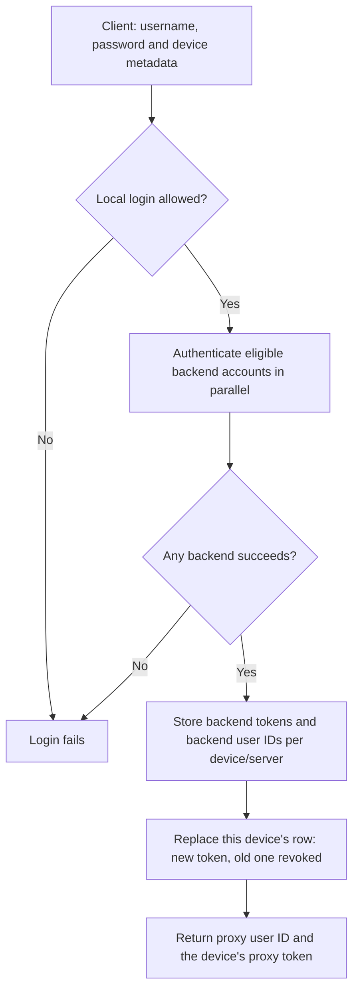
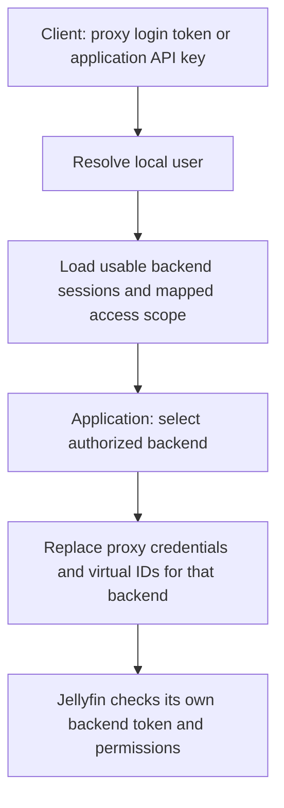
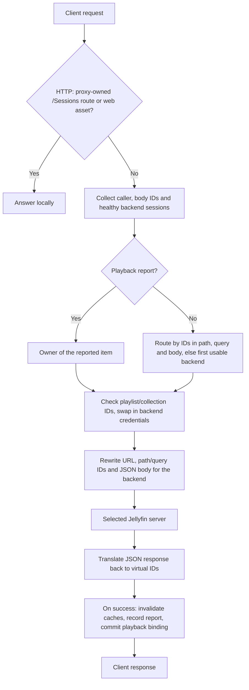
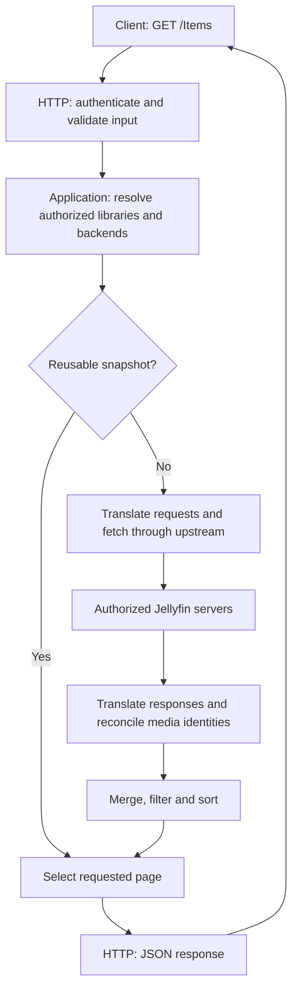
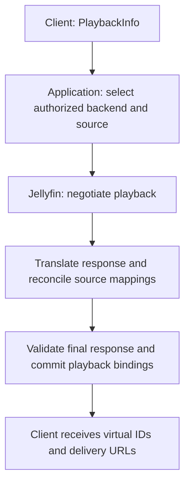
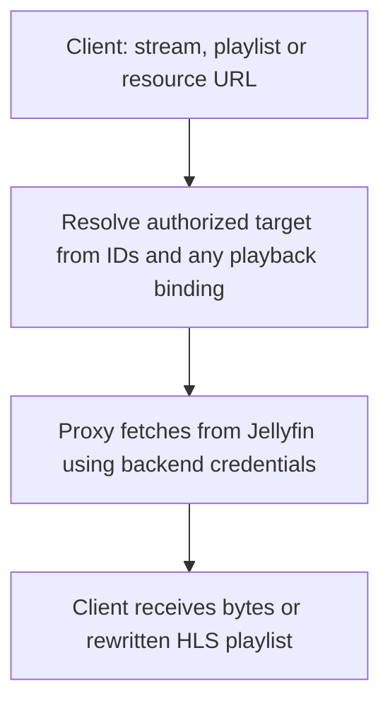
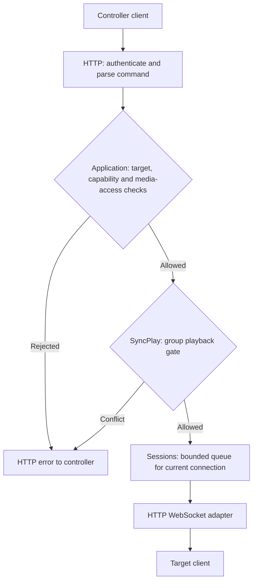

# Request and data flow

This guide follows authentication and client operations through the modules in
[Proxy architecture](ARCHITECTURE.md). All code paths are relative to `src/`.

## Before requests arrive

Startup constructs services in [startup/composition.rs](src/startup/composition.rs) and
assembles the client API and management UI in [http/router.rs](src/http/router.rs).
Handlers receive their service handles from `http/state.rs`.

## Authenticating with backend servers

JellyProxy-NG separates the **proxy login token** clients use from the **backend
tokens** Jellyfin servers accept. It follows Jellyfin's own model for both: a token
belongs to one **device** (one row per user and device id), logging the same device in
again replaces that row and revokes its previous token, and a request is identified by
its token alone (the `DeviceId` header only refreshes the device's name and version).

### Logging in

The client posts a username and password to `/Users/AuthenticateByName`, with
Jellyfin client/device metadata in its authorization header.

- **Existing user:** the local credential must pass first. Only saved server
  mappings are tried, using their backend usernames and decrypted credentials;
  these can differ from the proxy login. A saved backend Quick Connect token is
  validated against its expected backend user instead of a password login.
- **New user:** if automatic user creation is enabled, the supplied credentials
  are tried on configured servers. At least one must succeed before the local
  user and successful mappings are created. Otherwise login is denied.

Backend session tokens are encrypted in storage and belong to the device row
(`client_devices`): deleting the device (logout, or a new login of the same device)
deletes its backend sessions. The proxy logs in on each backend with a device id of
its own, stable for one client device (`backend_device_id`), so one device's re-login
never revokes another device's backend token. The login response substitutes the
local user's virtual IDs and uses the **device's** proxy token as its `AccessToken`
(only a SHA-256 hash is stored).

**Code:** [login handler](src/http/client_routes/mod.rs) →
[login orchestration](src/application/accounts.rs) →
[backend mapping authentication](src/auth/mapping_authentication.rs).

### Authenticating later requests

For a mapped user's request that needs a backend:

Tokens can arrive in supported Jellyfin authorization/token headers or an
`api_key`/`ApiKey` query parameter. The token resolves the user and the device;
the device's stored backend sessions are used, filtered for healthy servers. No
header string is compared with a stored one. When a backend answers 401 for a
stored token (revoked by Jellyfin, by an administrator, or by a newer login of the
same backend device), the proxy logs that device in again **once** for that session
(`application/session_recovery.rs`, one re-login at a time per session) and repeats
the request once; a Quick Connect mapping cannot be repaired this way and must be
reconnected in My servers. Requests do not otherwise repeat password
authentication. A mapping defines access
scope but does not by itself provide a usable backend session.
Application API keys are read-only proxy credentials, not new Jellyfin tokens.

**Code:** [token resolution](src/application/accounts.rs),
[request context collection](src/application/request/collect/mod.rs),
[stored sessions](src/auth/service/authorization_sessions.rs),
[outgoing credential replacement](src/application/request/builder.rs).

These diagrams describe mapped-user authentication. Some forwarding/media paths
also allow backend-token passthrough; that does not authenticate a local user.
Proxy Quick Connect is an alternative client login: approval redeems existing
mappings, registers backend sessions and returns the same proxy token
([workflow](src/application/quick_connect.rs)). Management-page login is separate
under `ui/`.

## Forwarding any other request

Most Jellyfin endpoints have no dedicated workflow. The router's catch-all
sends them, along with item mutations, trickplay and playback reports, to
**one** backend and translates the answer. This is the proxy's core path; the
sections below are specializations of it.

| Step | Code |
|---|---|
| Guard and entry point | [`http/forwarding.rs`](src/http/forwarding.rs) |
| Buffer the request | [`http/incoming.rs`](src/http/incoming.rs) |
| Collect caller context | [`application/request/collect/`](src/application/request/collect/mod.rs) |
| Select the backend | [`application/request/routing.rs`](src/application/request/routing.rs), [`application/playback/reports.rs`](src/application/playback/reports.rs) |
| Authorize the target | `OperationRequest::authorize_target` in [`application/request/input.rs`](src/application/request/input.rs), [`application/request/containers.rs`](src/application/request/containers.rs) |
| Build the upstream request | [`application/request/builder.rs`](src/application/request/builder.rs), [`translation/`](src/translation/mod.rs) |
| Send, translate, observe | `forward` in [`application/forwarding.rs`](src/application/forwarding.rs) |

A watched-state change on a merged item (`/UserPlayedItems/{id}` or
`/Users/{user}/PlayedItems/{id}`) is the one
exception to "one backend": it is applied to every authorized copy before the
client gets a response. Errors become status codes in
[`http/error.rs`](src/http/error.rs); only mixed-server playlist/collection
selections and unmapped users get a message body.

## Browsing the catalog

A `GET /Items` request may combine results from several authorized Jellyfin
servers into one listing.

**Code:** [HTTP handler](src/http/client_routes/mod.rs) →
[input extraction](src/http/extractors.rs) →
[catalog workflow](src/application/catalog/mod.rs).

The diagram shows a federated listing; single-owner requests can delegate to
`application/details/`. Application combines `translation/` for ID and URL rewriting,
`upstream/` for transport and `media/` for identity storage. A reusable snapshot
already contains the processed listing; cache hits only paginate it. Incomplete
results are not cached, and incomplete or stale fetches must not erase newer
inventory.

## Starting and delivering playback

Choosing a playable source and delivering its bytes are separate requests.
The mapped-user path below uses media mappings and playback bindings to keep
them on the right backend.

### 1. Negotiate a source

Explicit source selections win over episode-server preferences. Bindings are
published only after reconciliation and final-response validation.

**Code:** [negotiation](src/application/playback/negotiation/mod.rs),
[target selection](src/application/playback/target.rs).

### 2. Deliver the media

Delivery can use explicit media/source IDs without a prior `PlaybackInfo` request;
when a known binding is used, it must agree with the request's other routing inputs.
HLS links are translated for subsequent proxy requests. Media is always relayed: the proxy
never redirects a client to a backend URL (there used to be a per-server "redirect" mode,
removed in 2.1.0, which had to put the backend token in the URL).

**Code:** [delivery selection](src/application/playback/resources.rs),
[bindings](src/playback.rs),
[streaming](src/upstream/delivery.rs).

## Sending a remote-control command

`POST /Sessions/{id}/Playing` tells another connected client to play media. Unlike
stream delivery, the command stays inside JellyProxy-NG.

**Code:** [session routes](src/http/client_sessions/routes.rs) →
[application checks and coordination](src/application/client_sessions/mod.rs) →
[WebSocket delivery](src/http/client_sessions/websocket.rs).

Delivery failures also become HTTP errors.

Client sessions track presence and connections; playback bindings track media
routing. Accordingly, `/Sessions/Playing`, `/Sessions/Playing/Progress` and
`/Sessions/Playing/Stopped` are playback telemetry, not remote commands: they use
the media-report workflow and still reach the selected Jellyfin backend.
